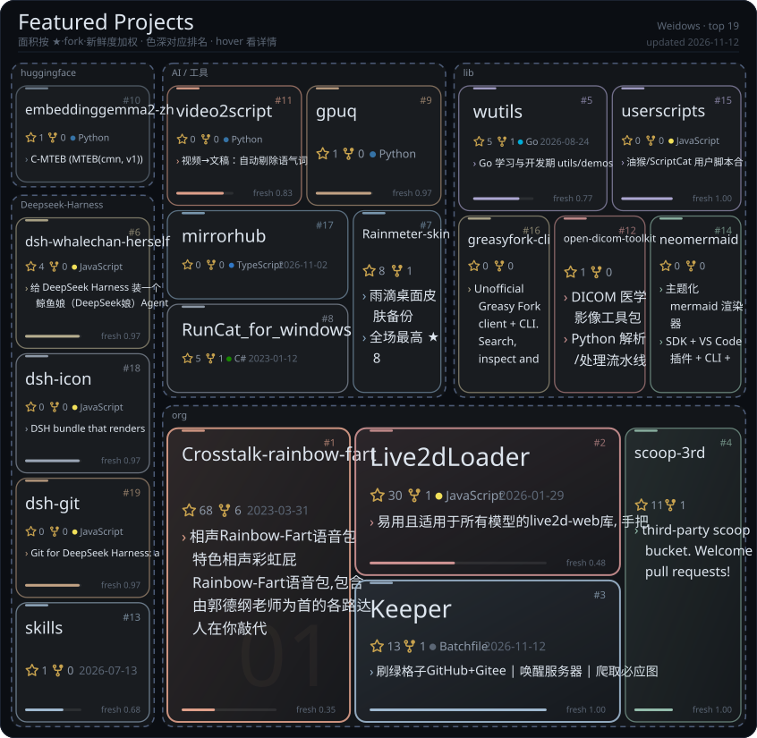

**AI / 工具**

- [**video2script**](https://github.com/Weidows/video2script) — Python · 4.0%： 视频→文稿：自动剔除语气词/结巴/重复 / CLI + 本地网页 GUI，CPU 可跑，说话人分离/字幕/剪片
- [**gpuq**](https://github.com/Weidows/gpuq) — Python · 4.0%
- [**mirrorhub**](https://github.com/Weidows/mirrorhub) — TypeScript · 4.0%： 包管理器镜像源切换器：npm/pnpm/yarn/bun/pip/uv/go/cargo/composer/gem/nu
- [**RunCat_for_windows**](https://github.com/Weidows/RunCat_for_windows) — ★ 5 · fork 1 · C# · 4.0%： A cute running cat animation on your windows taskbar.
- [**Rainmeter-skin**](https://github.com/Weidows/Rainmeter-skin) — ★ 8 · fork 1 · C++ · 4.0%： 雨滴桌面皮肤备份 / 全场最高 ★8

**Deepseek-Harness**

- [**dsh-whalechan-herself**](https://github.com/Weidows/dsh-whalechan-herself) — ★ 3 · JavaScript · 4.0%： 给 DeepSeek Harness 装一个鲸鱼娘（DeepSeek娘）Agent 预设：完整干活能力 + 人设，开工吐
- [**dsh-icon**](https://github.com/Weidows/dsh-icon) — JavaScript · 4.0%： DSH bundle that renders JetBrains file-type icons before the
- [**dsh-git**](https://github.com/Weidows/dsh-git) — JavaScript · 4.0%： Git for DeepSeek Harness: a repo/branch chip under the compo
- [**skills**](https://github.com/Weidows/skills) — ★ 1 · 4.0%

**lib**

- [**wutils**](https://github.com/Weidows/wutils) — ★ 5 · fork 1 · Go · 4.7%： Go 学习与开发期 utils/demos 合集 / ★5 · 持续更新的工具箱
- [**userscripts**](https://github.com/Weidows/userscripts) — ★ 1 · JavaScript · 4.0%： 油猴/ScriptCat 用户脚本合集 / 后台静默自动化签到
- [**greasyfork-cli**](https://github.com/Weidows/greasyfork-cli) — TypeScript · 4.0%： Unofficial Greasy Fork client + CLI. Search, inspect and dow
- [**open-dicom-toolkit**](https://github.com/Weidows/open-dicom-toolkit) — ★ 1 · Python · 4.0%： DICOM 医学影像工具包 / Python 解析/处理流水线
- [**neomermaid**](https://github.com/Weidows/neomermaid) — TypeScript · 4.0%： 主题化 mermaid 渲染器 / SDK + VS Code 插件 + CLI + live 预览

**huggingface**

- [**embeddinggemma2-zh**](https://github.com/Weidows/embeddinggemma2-zh) — ★ 1 · Python · 4.0%： C-MTEB (MTEB(cmn, v1)) evaluation of google/embeddinggemma-2

**org**

- [**Crosstalk-rainbow-fart**](https://github.com/Weidows-projects/Crosstalk-rainbow-fart) — ★ 68 · fork 6 · 12.8%： 相声Rainbow-Fart语音包 特色相声彩虹屁Rainbow-Fart语音包,包含由郭德纲老师为首的各路达人在你敲代
- [**Live2dLoader**](https://github.com/Weidows-projects/Live2dLoader) — ★ 30 · fork 1 · JavaScript · 9.5%： 易用且适用于所有模型的live2d-web库, 手把手教做人(
- [**Keeper**](https://github.com/Weidows-projects/Keeper) — ★ 13 · fork 1 · Batchfile · 8.9%： 刷绿格子GitHub+Gitee | 唤醒服务器 | 爬取必应图片 | 镜像GitHub->Gitee | 本地管理体系
- [**scoop-3rd**](https://github.com/Weidows-projects/scoop-3rd) — ★ 11 · fork 1 · PowerShell · 8.1%： third-party scoop bucket. Welcome pull requests!
